  

  
  
  
  

## 👋 About me

I'm a CS graduate from Amman, Jordan. I co-founded [Sirocco](https://www.sirocco.digital/), where we build autonomous drones for inspection. There I'm the computer vision backend engineer. I also work as a junior AI engineer, mostly on AI developer tools and the backends behind them.

## 🔭 Right now

- 🚁 **[Sirocco](https://www.sirocco.digital/)**: the computer vision backend for our inspection drones
- 🔍 **CodeAtlas**: an AI code search engine for repositories 

## 🧰 Tech I use

  
  
  
  
  
  
  
   
  
  
  
  
  
  
  

## 🌍 Open source

## 🏆 Hackathons

## 🚀 Projects

  
  
  
  

Smaller things: [Network](https://github.com/yosefther/Network) (UDP sockets and a raw packet sniffer in C and Python) and [Alien-Invasion](https://github.com/yosefther/Alien-Invasion) (a Pygame arcade shooter).

## 💬 Ask me about

Drones, ray casting, or how a renderer ends up scaling the same light twice.

## 🐍 My contributions, being eaten

<picture>
  <source media="(prefers-color-scheme: dark)" srcset="https://raw.githubusercontent.com/yosefther/yosefther/output/github-snake-dark.svg">
  
</picture>
