<!-- Generated by tools/profile_graphics.py. Edit the script, not this file. -->


<a href="https://www.sirocco.digital/"></a>


<a href="https://github.com/cyberbotics/webots/pulls?q=is%3Apr+author%3Ayosefther+is%3Amerged"></a>

<a href="https://github.com/yosefther/spring-initializr-cli"></a><a href="https://github.com/yosefther/hermes-telegram-assistant"></a>

<a href="https://github.com/yosefther/rayCast3D"></a><a href="https://github.com/siglag/hackathon"></a>

<a href="https://github.com/yosefther/TODO_golang"></a><a href="https://github.com/yosefther/Network"></a><a href="https://github.com/yosefther/Alien-Invasion"></a>


