CS student from Amman, Jordan. I enjoy building backend projects, learning new things, and contributing to open source.

Currently focusing on backend development and infrastructure. I'm also working on [Sirocco](https://sirocco.digital).

Languages I use: Python, Go, C/C++, and SQL.

## Projects

- [Ironlark](https://github.com/yosefther/Ironlark): A Linux drone simulation setup with Webots, ArduPilot, ROS 2, and Docker. Includes sensor recording, flight checks, and renderer patches.
- [Zagoat](https://github.com/yosefther/zagoat): A coding practice platform with a FastAPI backend, Postgres, Redis job queues, OAuth, and a containerized code runner. Still in development.
- [Corporate Financial Statement Analyzer](https://github.com/yosefther/Corporate-Financial-Statement-Analyzer): A C# desktop app for reviewing financial statements and metrics, with a web dashboard demo.
- [RayCast3D](https://github.com/yosefther/rayCast3D): A ray-casting engine built with Python and Pygame, with collision detection, a minimap, and a ray debug view.

## Open source contributions

- [Webots](https://github.com/cyberbotics/webots/pulls?q=is%3Apr+author%3Ayosefther): Rendering fixes and mesh processing improvements.
- [py-tree-sitter](https://github.com/tree-sitter/py-tree-sitter/pulls?q=is%3Apr+author%3Ayosefther): Fixes for callback lifetimes and node return values.
- [knots](https://github.com/behnamazimi/knots/pulls?q=is%3Apr+author%3Ayosefther): Rendering and mesh performance improvements.
- [JOSA](https://github.com/search?q=org%3Ajordanopensource+author%3Ayosefther+is%3Apr&type=pullrequests): Submitted fixes for month-end rankings and broken links.

[All pull requests](https://github.com/search?q=author%3Ayosefther+is%3Apr&type=pullrequests) · [Merged PRs](https://github.com/search?q=author%3Ayosefther+is%3Apr+is%3Amerged&type=pullrequests) · [Issues I've opened](https://github.com/search?q=author%3Ayosefther+is%3Aissue&type=issues)

[yousefthair9@gmail.com](mailto:yousefthair9@gmail.com) · [sirocco.digital](https://sirocco.digital)
